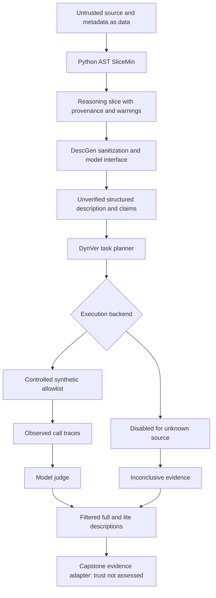

# Architecture and integration contracts

| Module | Input | Output | Boundary |
|---|---|---|---|
| `slicemin.PythonSlicer` | Source directory, tool name, reviewed optional entry | Slice source, functions, edges, unresolved calls, source hashes, revisions, warnings | No imports/execution; Python subset only |
| `descgen.generate` | Slice object + Model | Unverified description, claim targets, sanitizer provenance, prompt/input hashes | JSON schema checks do not establish truth |
| `dynver.verify` | Description + Model + Runner | Full/lite, per-claim decisions, traces, usable-summary flag | Unsupported claims filtered; trust decision remains not assessed |
| `common.models.Model` | Stage/system prompt/payload | JSON object + local audit | Replay or explicitly configured HTTP; remote/paid gate |
| `sandbox.Runner` | Natural-language task | Backend ID, status, events | Interface alone cannot authenticate an external backend |
| `dataset.prepare` | Provenance-bearing JSONL | Normalized JSONL/checksummed manifest/statistics | No invented labels or paper splits |
| `evaluation` | Reviewed task results | TSR and paired overhead | Reject missing labels/duplicates/incomplete requested coverage |
| `pipeline.run_pipeline` | Source, models, runner, fresh output | Saved stage artifacts and failure state | Preserve partial successful stages; refuse stale directories |

## Data formats

Objects are plain JSON, avoiding framework-specific dependencies. Each slice names its analysis mode. Each model audit names inference/replay mode and prompt/payload hashes. Every description prose claim has a stable ID and a path to its full text. Every verification decision identifies that claim and distinguishes supported/refuted/inconclusive/not-runtime-verifiable. A task log is evidence from a particular execution backend, not a general safety certificate.

Raw source and model responses are untrusted data throughout. AST output is a reasoning representation, not deployable code. The package never loads arbitrary modules from datasets. Model-service keys are constructed only from explicitly supplied configuration and never from source or tool descriptions.

## Team boundaries

Suraj can supply reviewed threat scenarios, source snapshots and adversarial fixture cases via the dataset schema, without bypassing execution policy. Sanchita can build explanations from claim decisions, source hashes, tasks and traces; she should preserve inconclusive outcomes and avoid recasting them as confident risk scores. Niharika can ingest/source/license/pin artifacts and prepare manifests, retaining unknown labels as null. The future trust gate should consume these evidence records with the team's policy layer; no arbitrary semantic–behavioral score is invented in Phase 1.

For a real MCP runner, implement the Runner interface in a separate isolated service. Bind source hashes to the installed server revision; enforce permitted tools, resource limits, task deadlines and capped trace storage; keep model credentials outside the untrusted runtime; validate isolation with canary probes; record dependency/environment failures. Do not merely add a subprocess call in `ControlledAgent`.
