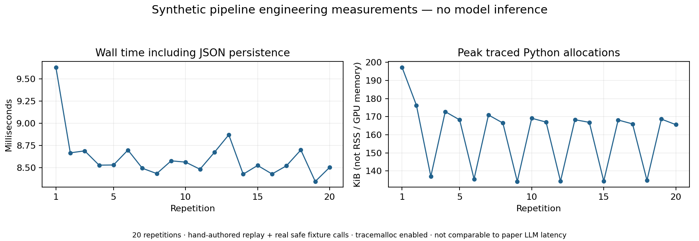

# Published versus measured comparison

No original-condition metric was measured. Blank measured/difference cells in `published_results.csv` mean **not run**, not zero. It contains 201 quantitative reference entries from Tables 2–6 and printed evaluation findings. Table 1 source metadata and Table 7 reported attack outcomes are separate manifests. Exact Figure 7 per-iteration data are not printed and are not invented.

| Paper metric | Published result | Source / condition | Our original-condition measurement | Why |
|---|---|---|---|---|
| Original-description TSR | 84.1% (175/208) | Table 2 p.10 | Not run | Original tasks, sources and execution configuration missing |
| Full TSR, four-model mean | 87.7% (182.5/208 mean) | Table 2 p.10 | Not run | Four generation models not executed |
| Lite TSR, four-model mean | 86.3% (179.5/208 mean) | Table 2 p.10 | Not run | Same gap; lite only removes functionality list |
| Gemini-3-Flash generation | $0.013 / tool, 25.7 s / tool | Table 4 p.11 | Not run | No approved paid inference / original prompts |
| Lite runtime overhead | +4.0% cost, +0.2% latency | Table 5 p.12, common-success tasks | Not run | Matched real task traces missing |
| Full runtime overhead | +0.3% cost, −1.7% latency | Table 5 p.12 | Not run | Matched real task traces missing |
| Degraded selection means | 41.6%, 18.8%, 14.5% | p.2 / Table 6 p.12, three degradation types | Not run | Original tools/mutations/tasks/agent unavailable |
| Trigger-text removal | All seven examples reported blocked | Table 7 p.12 | Not run | Not an end-to-end ASR metric; no reproduction executed |
| Adaptive selection range | 44.7–67.4%, 15 iterations | §5.5 / Figure 7 p.13 | Not run | Original adaptive loop/resources missing |

The full-vs-original mean increase is approximately 3.6 percentage points, or 4.3% relative using counts. Do not call the paper's 4.3% a percentage-point improvement. Preserve the tabulated GPT-5.2 lite/full ordering and gpt-oss lite tie with original despite broader narrative wording.

## What we actually measured

The local suite passes 91 tests on Python 3.13.9 and Python 3.11. Five portable CPU notebook cells execute locally. Eight synthetic task records validate with unknown labels preserved. Twenty synthetic replay pipeline repetitions record real fixture function calls, local file writes and Python allocation peaks. One manually authored false statement is refuted by actual missing-prefix errors; an internal-implementation statement is removed as nonverifiable. The semantic planner/judge responses are hand-authored replay, so this does not measure an LLM's detection ability.

A separate real-source **static-only** check parses 31 Python files from a pinned public arxiv server, uses a reviewed handler override, finds 23 reachable functions, and reports 194 unresolved call sites. Current source lists 19 exposed tools, while the paper evaluated four from that server at an unspecified revision. This provides concrete source-drift/coverage evidence without executing third-party code. None of those counts is original TSR, attack success or proof of faithful SliceMin equivalence.

These timings are instrumentation measurements of replay and fixture mechanics. No meaningful numeric difference from the paper can be calculated because workloads, models, tool sets, dependencies and agents differ. No estimated original result or claimed improvement is supplied.
