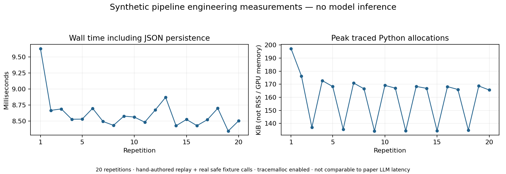

# Phase 1 technical report

**Hybrid Semantic-Behavioral Trust Verification for Third-Party AI Agent Tools**  
TRUSTDESC reproduction work — 8 November 2026, Asia/Kolkata.

## Outcome and scientific status

A working, modular, tested **bounded reimplementation** and independent Colab handover are delivered. Original-condition scientific reproduction is **incomplete**. The package supplies feasible implementations and explicit blockers, as required by the Phase 1 completion definition; it does not mark missing experiments complete or call replay a successful research reproduction.

The first two milestones were completed before substantial code: environment inspection, source fingerprint/version confirmation, entire 17-page paper reading, visual table/figure checks, scientific analysis and an evidence ledger. Work then continued through implementation, tests, feasible experiments, review documents and handover. This is the student's ML/defense/reproduction contribution, not the entire team's two-year system.

## Research findings

TRUSTDESC derives tool descriptions from source through reachability-aware SliceMin, code-grounded DescGen and dynamic task-based DynVer. It assumes accessible source and no overt malicious runtime implementation. Its threat scope covers explicit/implicit poisoned descriptions and semantics-bearing code artifacts, rather than general malware or all MCP trust decisions. Full includes summary/functionality list/schema; lite removes only the refined functionality list.

The paper's evaluation uses 52 tools from 12 servers, 208 generated tasks and four generation models. A Gemini-3-Flash ReAct agent executes the task benchmark. Published full/lite mean TSR is 87.7%/86.3%, versus 84.1% original. The advertised 4.3% increase is relative (about 3.6 percentage points). Code, prompts, exact sampled tools/revisions/tasks/labels and detailed serving settings were not obtained. All published numbers remain distinct from our measurements.

Detailed analysis: [PAPER_ANALYSIS](../docs/PAPER_ANALYSIS.md). Numeric cells: [published_results.csv](published_results.csv), with 201 rows and blank original-condition measured/difference fields. Server/attack manifests preserve PDF hyperlinks and printed metadata. No exact Figure 7 trajectory is fabricated.

## Artifact discovery and feasibility

The public arXiv record and author's homepage corroborate the publication. The suggested anonymous service explicitly reports expiry; its linkage to this PDF is not independently authenticated. Public title/author searches and a GitHub repository-name/description API query found no authenticated alternate release (the latter returned zero matches). Initial sandbox DNS failures were environment restrictions, subsequently resolved for scoped public acquisition; they were never treated as evidence of a global outage.

One paper-linked tool repository was acquired: `blazickjp/arxiv-mcp-server`, commit `572e301bb3198962c025d5ed5e14becb86868daa`, 490,822 archive bytes, SHA-256 `933aaafd43e4e166caccbf5cc46fff0f52fdb3c733e58d03a5253b4ca4b12158`. API metadata and LICENSE identify Apache-2.0. It is a tool source, **not TRUSTDESC's implementation**. Current source has 19 tool-list entries, whereas the paper selected four from an unknown revision. Raw external source is ignored/excluded from distribution. No external setup/server/test/skill instructions were run/followed.

See [evidence ledger](../docs/EVIDENCE_LEDGER.md), [acquired source manifest](../data/manifests/acquired_sources.json) and [static evidence](public_static_experiment.json).

## Implemented software

| Area | Delivered behavior | Material difference or blocker |
|---|---|---|
| SliceMin | Python AST indexing, registrations, ordinary import/alias resolution, DFS with all callers/sites, external/unresolved call records and source hashes; optional per-node model rewrites/reconnection | Python subset instead of tree-sitter; TypeScript, automatic dispatch/LLM entry fallback, methods/closures/dynamic semantics incomplete; rewrite equivalence unproven |
| DescGen | Comment/docstring removal, 20-character token normalization, collision rejection, contextual model rename stage, structured descriptions and complete prose-claim coverage | Reconstructed prompts; original models/classifier not run; schema checks do not establish truth |
| DynVer | Per-claim task planning, bounded agent interface, execution logs, judge interface, supported-claim filtering and full/lite output | Semantic steps replayed locally; one-pass removal without automatic argument repair; structural schema semantics uncertified |
| Execution | Actual calls to two fixed authored fixtures; unknown code disabled; review-only container proposal | No real isolation boundary or LangChain/MCP backend validated |
| Data | Public quarantined acquisition interface, schema/annotation/provenance checks, deduplication, checksums, statistics and optional group splits | Exact author benchmark unavailable; eight synthetic task records only |
| Evaluation | Reviewed target-invocation + objective-success TSR, duplicate/coverage checks, paired three-condition common-success overhead | No original-condition result inputs; exact paper overhead aggregation unspecified |
| Model access | Replay, explicit OpenRouter-compatible HTTP and optional opt-in small-model GPU adapter; local audits | No paid use/credentials; HTTP transport mocked; GPU inference not executed |

Architecture, data contracts and team integration responsibilities are documented in [ARCHITECTURE](../docs/ARCHITECTURE.md), with detailed [METHODOLOGY](../docs/METHODOLOGY.md), [decisions](../docs/IMPLEMENTATION_DECISIONS.md) and [status matrix](../docs/REPRODUCTION_STATUS.md). The future trust gate should consume evidence without treating a limited supported claim as a safety certificate.

## Validation and debugging

The final core suite runs **91 tests, 91 passing, 0 failures, 0 errors, 0 skipped**, on Python 3.13.9 and Python 3.11. Includes integration/partial-stage/stale-output handling; helper cycles/import aliases/ambiguous registrations; malformed rewrites and model responses; unsupported/nonverifiable claims; provider timeout, dependency, malformed-log and sandbox failure simulations; blocked tool requests; dataset/provenance/label checks; and reviewed-result metrics.

The notebook has **10 compiled code cells**, with **five portable CPU cells executed locally**. Upload, GPU/download and export cells were not executed. Actual Colab session behavior remains unvalidated. Test commands/results and a debugging chronology are saved in [EXPERIMENT_LOG](../docs/EXPERIMENT_LOG.md), [test_results.json](test_results.json), [test_output.txt](test_output.txt), [Python 3.11 output](test_python311.txt), and [notebook validation](notebook_validation.txt).

Code review fixed AST comparison handling before first tests, added output-freshness protection against stale verification records, and rejected conflicting duplicate-content annotations. No failures were hidden through skipped tests. Resource-dependent features that are not implemented are documented gaps, not skipped successes.

## Feasible experimental evidence

### Synthetic engineering pipeline

Twenty repetitions use fixed hand-authored model replay and **real bounded fixture function calls**. Four execution traces per run demonstrate ordinary acceptance, missing-prefix rejection, two disallowed-formula errors and a valid text input. Expected replay decisions retain three claims, refute one false auto-prefix claim and discard one internal-organization claim as nonverifiable. These are engineering expectations; there is no claim that an actual LLM discovered the errors.

| Measured quantity | Actual local result | Scope |
|---|---|---|
| Repetitions | 20 | Fixed replay + controlled functions |
| Median wall time | 8.529 ms | Includes JSON persistence and tracemalloc |
| Min / max wall time | 8.344 / 9.630 ms | Same instrumented workload |
| Maximum traced allocation | 202,061 bytes (197.3 KiB) | Python allocations, not RSS/native/GPU memory |
| Remote/API calls / paid cost | 0 / $0 | No inference performed; not a model price estimate |
| Synthetic task records | 8 | 2 tool groups, all 8 labels unknown, no duplicates |

Raw timing rows, source/config hashes, runtime and timestamps are in [local_experiments.json](local_experiments.json). [One complete trace set](local_example/verification.json) is versioned; repetitive local raw runs remain in the ignored directory identified by that report. Timing results are **not comparable to the paper's LLM generation seconds**.

### Real public-source static analysis

Parsed 31 Python files, using an explicitly reviewed `arxiv_mcp_server.tools.search:handle_search` override because automatic dispatcher registration is unsupported. Recorded 23 reachable functions, 35 resolved call sites and 194 unresolved call sites, in 0.153 seconds for parsing/traversal. No original tool execution, LLM descriptions, DynVer task execution, attack outcome or paper TSR was measured. Reachability completeness is unproven; unresolved calls are a substantive limitation. The current 19-entry tool list demonstrates why version pinning matters.

## Comparison and gap analysis

[COMPARISON](COMPARISON.md) distinguishes printed paper results from local observations. Every original-condition measured/difference cell stays blank. Recovered source links/current snapshot do not reconstruct the 52 original tool selections or 208 tasks. Synthetic outcomes, a successful CLI exit, or a fast static traversal cannot establish paper reproduction. No defense improvement is claimed.

## Colab handover and portability

The independent [handover guide](../docs/COLAB_HANDOVER.md) and notebook explain runtime choice, checksum-verified upload, exact commands, data acquisition, configurations, checkpoints, disconnect recovery, export and validation. CPU replay needs no extra package install/GPU. Optional Qwen 1.5B inference has explicit download opt-in, pinned direct dependencies/revision prefix, bounded contexts, raw output/failure capture and no credentials/custom remote code. **It was not run locally and is not equivalent to the original models.** Original gpt-oss-120b used four RTX PRO 6000 Blackwell GPUs; exact memory/precision/stack were not specified.

The portable archive contains tracked source/configuration/tests/docs/notebook and saved small evidence files, plus a per-file SHA-256 manifest. It excludes `.git`, virtualenv, secrets, model weights, private PDF, raw/interim external source and repeated run directories. Packaging requires a clean local Git state. `validate_package.py` verifies names and every member hash; a separate archive smoke check is performed after report creation. Git history remains in the local repository; nothing is pushed or published.

## Deliverable checklist

- [x] Complete paper analysis, quantitative references and evidence ledger.
- [x] Verified discovery attempts; one pinned source acquisition and explicit original-artifact gaps.
- [x] Documented methodology, architecture, decision log and security assessment.
- [x] Bounded SliceMin, DescGen and DynVer code, with faithful-reproduction blockers stated.
- [x] Acquisition/preparation pipeline and eight explicitly synthetic tasks; no invented labels.
- [x] Reproducible configurations, unit/integration tests and debugging record.
- [x] Feasible local synthetic and real-source static experiments with saved evidence.
- [x] Published-versus-measured comparison without fabricated original results.
- [x] Notebook, handover, README, review preparation and final technical report.
- [x] Local logical Git milestones; final clean-state/package validation performed at delivery.
- [ ] Recover exact authenticated author implementation, prompts and 208-task benchmark.
- [ ] Implement/validate full-language and isolated real MCP/LangChain execution parity.
- [ ] Obtain separately authorized original-model access and run original-condition evaluation.
- [ ] Execute/validate optional GPU notebook on the student's own Colab runtime.

## Next work, in dependency order

1. Recover authenticated original release or obtain author clarification about code, exact selected tools/commits, prompts/tasks/judge labels/model IDs. This is a genuine input blocker, not a routine engineering choice the student should have to guess.
2. Acquire licensed pinned benchmark snapshots and check schema/counts/labels without executing source. If reconstructing tasks instead, preserve the reconstructed label and do not compare as exact original reproduction.
3. Extend parser/registration resolution for needed Python/TypeScript patterns; validate slicing against source and call-context cases. Record all resolver/rewrite differences.
4. Build and probe a disposable isolated MCP runner with capped resources/logs, no host secrets, controlled egress and enforced cleanup. Real-source execution remains disabled until then.
5. After explicit model-cost/data-transmission authorization, freeze exact model/prompt/agent settings, execute original/full/lite task evaluations and manually review target invocation/objective success. Then compute matched TSR/overhead and report uncertainty/repetitions.
6. Only after a model-backed baseline exists, evaluate capstone extensions such as conditional-behavior verification and explanations. Compare measured outcomes rather than asserting an improvement.

The code is ready as an evidence-producing research scaffold for team integration. It is not a production tool safety verifier or a completed quantitative reproduction. [Review preparation](../docs/REVIEW_PREPARATION.md) provides faculty-facing explanations and anticipated questions; [LIMITATIONS](../docs/LIMITATIONS.md) records the remaining technical and scientific limits.
